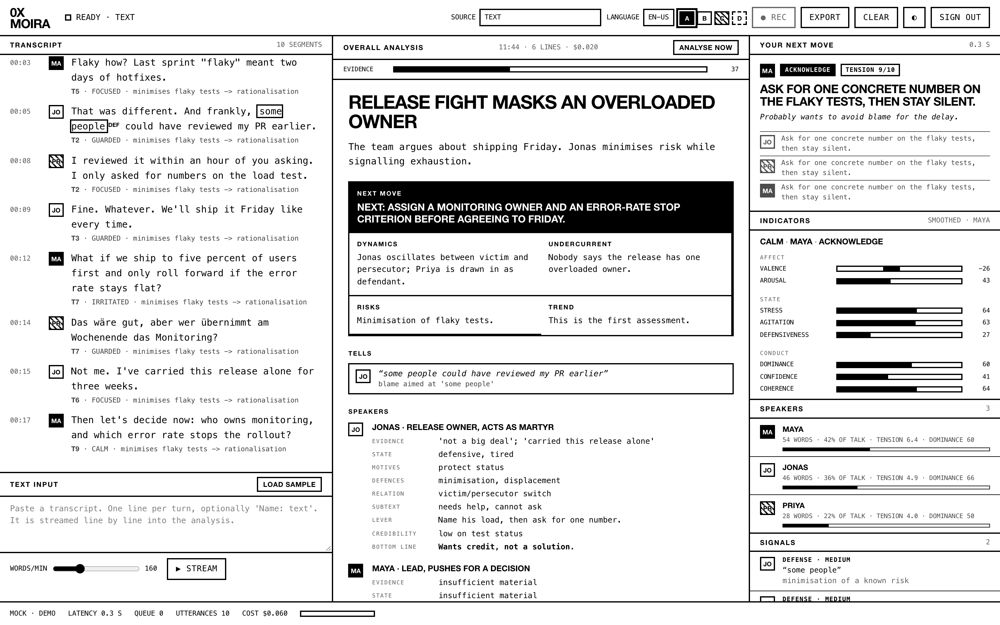
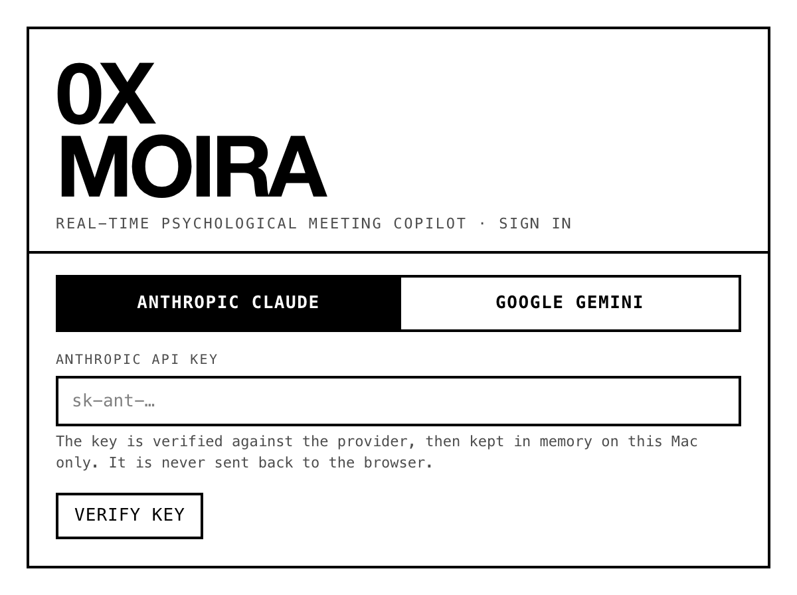
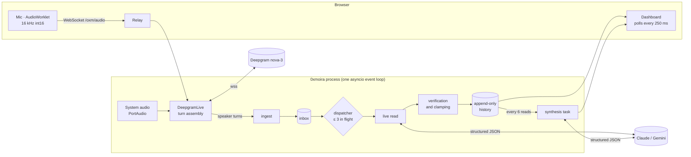

# 0xmoira

**A real-time, evidence-grounded psychological copilot for live meetings.**

Built at the AI Hackathon Berlin (Jamie).



<sub>Dashboard during a scripted demo conversation. The analysis values in this screenshot come from a deterministic test stub, not from a live model run.</sub>

---

## Abstract

Meetings fail less often on content than on what goes unsaid: defensiveness, status contests, unspoken fears and decisions that nobody owns. 0xmoira listens to a conversation as it happens, separates the speakers by voice, and produces two layers of analysis with a large language model (LLM).

1. **Live reads.** About three seconds after each turn, it gives a cue-to-inference reading of the speaker: tension, affect, dominance, defensiveness, flagged phrases and ideas. Each reading ends with one concrete move the user can make in the next ten seconds.
2. **Synthesis.** Every few turns it writes a running overall assessment: telling quotes, a profile of each speaker, the group dynamics, the undercurrent, risks and the single most useful next step.

The design rests on three principles:

- **Evidence before inference.** The model states the observable cue before it gives any number.
- **Verification against the transcript.** Every quoted phrase, idea and "tell" is checked against what was actually said; anything that can't be found is discarded.
- **Calibration against each speaker's own baseline.** A habitually blunt speaker is not scored as agitated for being blunt.

The system runs locally as a single asyncio process with a browser interface. It uses Anthropic Claude or Google Gemini for reasoning and Deepgram for streaming speech recognition with speaker separation (diarization).

---

## Contents

1. [Quick start](#1-quick-start)
2. [System architecture](#2-system-architecture)
3. [Method](#3-method)
4. [Theoretical grounding](#4-theoretical-grounding)
5. [Measured performance](#5-measured-performance)
6. [Configuration](#6-configuration)
7. [Repository layout](#7-repository-layout)
8. [Privacy and security](#8-privacy-and-security)
9. [Ethics, validity and limitations](#9-ethics-validity-and-limitations)
10. [Evaluation agenda](#10-evaluation-agenda)
11. [References](#11-references)
12. [Acknowledgements and citation](#12-acknowledgements-and-citation)

---

## 1. Quick start

```bash
git clone https://github.com/deepware13/0xmoira.git
cd 0xmoira
python3.12 -m venv .venv            # Python 3.11 or newer
.venv/bin/pip install -r requirements.txt
.venv/bin/python main_ui.py         # http://127.0.0.1:8080
```



**Sign in.** Choose **Anthropic Claude** or **Google Gemini** and paste an API key. The key is verified against the provider's model list, and you pick the analysis model (default: `claude-sonnet-5-5`). For live transcription with speaker separation, add a **Deepgram** key. Keys can optionally be saved to `~/.oxmoira/credentials.json`, which only your user account can read. Keys in `ANTHROPIC_API_KEY`, `GEMINI_API_KEY` or `DEEPGRAM_API_KEY` can be used directly.

**Run.** Press **● REC** and speak. To try it without a microphone, set the source to **TEXT**, click **LOAD SAMPLE**, then **▶ STREAM**.

<br clear="right">

### Input sources

| Source | Requirements | Speaker separation | Typical transcript latency |
|---|---|---|---|
| **Mic · Deepgram** | Deepgram key. The browser streams 16 kHz PCM to the app, which relays it to Deepgram `nova-3`. | Voice-based diarization | Sub-second (vendor specification; not benchmarked here) |
| **System audio · Deepgram** | Deepgram key and an input device that carries the call audio (e.g. BlackHole 2ch) | Voice-based diarization | Same as above |
| **Mic · browser speech** | Chrome, Edge or Safari (Web Speech API) | None. Set the current speaker with the A–D badges. | Sub-second |
| **System audio · Gemini** | Gemini key | Gemini assigns labels per audio chunk | 1–3 s per chunk |
| **System audio · ASR endpoint** | `OXMOIRA_ASR_URL` returning `{utterance_id, speaker, text, duration_ms}` | From the endpoint | Depends on the endpoint |
| **Text** | None | `Name: text` per line | Simulated at a chosen words-per-minute rate |

The language selector includes **EN+DE**, which uses Deepgram's multilingual mode for meetings that switch between English and German.

---

## 2. System architecture



**Concurrency model.** Everything runs on NiceGUI's single event loop. The only extra thread is PortAudio's real-time callback, which copies the audio block and hands it over with `call_soon_threadsafe`. Network calls are awaited, so a slow model response can never freeze the interface or drop audio. The UI reads append-only state through index cursors, so any number of browser tabs can observe one session.

---

## 3. Method

### 3.1 Turn segmentation

**Streaming path (Deepgram).**
- **Request parameters:** `model=nova-3`, `diarize_model=latest`, `interim_results=true`, `endpointing=300`, `utterance_end_ms=1000`, `smart_format=true`.
- **Final results:** words from final results are buffered with their `speaker` field. On every final result the buffer is split into runs of consecutive words from the same speaker. Every completed run is emitted as a turn, and the last run stays open.
- **End of speech:** on `speech_final` or `UtteranceEnd`, all runs are emitted.
- **Long monologues:** a run longer than 60 words is emitted early so the analysis keeps up.
- **Interim text:** interim results are shown in the transcript panel as provisional text, labelled with the presumed speaker.

**Chunked path (Gemini or a custom endpoint).** An energy-based voice activity detector works on 30 ms frames of RMS amplitude $r_t$, with an adaptive noise floor $\hat n$:

$$\text{speech}_t \iff r_t \ge \max(r_{\min},\, k\,\hat n), \qquad \hat n \leftarrow 0.95\,\hat n + 0.05\,r_t \ \text{ on non-speech frames}$$

with $r_{\min}=0.006$ and $k=3$. A turn ends after 450 ms of silence or 8 s of speech, and includes 300 ms of pre-roll audio. Chunks are transcribed concurrently (up to 3 at a time) but emitted strictly in order.

### 3.2 Live read

Each turn becomes one stateless request. The request contains:

1. a cached system prompt;
2. a rolling window of the last $W=10$ turns, each annotated with the model's earlier read of it (`<read: tension, mood>`);
3. the speaker's smoothed baseline (§3.3);
4. the new turn.

The window and baseline are captured when the turn **arrives**. Concurrent requests therefore each see the conversation as it stood when their turn arrived. The prompt marks earlier reads as context, not evidence, so the model doesn't confirm its own past judgements.

The answer is constrained by a JSON Schema: Anthropic structured outputs (`output_config.format`) or Gemini `responseJsonSchema`. Fields are generated in this order:

| Order | Field | Scale | Notes |
|---|---|---|---|
| 1 | `evidence` | text, ≤ 25 words | "cue → reading". Written first so the numbers that follow are tied to an observed cue. |
| 2 | `cognitive_tension_score` | 1–10 | Anchors: 1–3 relaxed; 4–6 friction or hedging; 7–8 strained; 9–10 acute |
| 3 | `mood`, `valence`, `arousal` | label; −100…100; 0…100 | |
| 4 | `dominance`, `stress`, `defensiveness`, `confidence`, `agitation`, `coherence` | 0…100 | Neutral speech scores 40–60. Values beyond 20 or 80 need a clear cue. |
| 5 | `underlying_intent` | one sentence | Phrased as an inference, hedged once |
| 6 | `flags[≤3]` | verbatim phrase, category, reason, severity | Categories: defense, power, deceptive, evasive, contradiction, difficult, emotional |
| 7 | `ideas[≤1]` | verbatim source, kind, novelty 0–100, "spin" | |
| 8 | `intervention_type`, `tactical_action` | enum; ≤ 25 words | probe, reframe, acknowledge, pause, boundary, redirect, hold |

**Latency.** For live reads the model's extended thinking is switched off (`thinking: {type: "between_tools"}` on Sonnet 5.5) and effort is set to `low`. The synthesis keeps adaptive thinking at `medium` effort. §5 has the measured effect.

### 3.3 Speaker baselines

Single utterances are noisy, and people differ in their default register. For each speaker $s$ and score $x$, 0xmoira keeps an exponentially weighted moving average:

$$b^{(s)}_t = \alpha\, x^{(s)}_t + (1-\alpha)\, b^{(s)}_{t-1}, \qquad \alpha = 0.4$$

From the speaker's second analysed turn on, the baseline is included in the prompt, and the model is told to score the **deviation from it**. The indicator panel also shows these smoothed values rather than the raw per-turn scores.

### 3.4 Grounding and verification

Model output is treated as a hypothesis that is checked mechanically before it is shown:

- **Verbatim grounding.** A flag's `phrase`, an idea's `source` and a tell's `quote` must appear in the actual text after normalisation: case-folding, stripping punctuation, collapsing whitespace. If not, they are dropped silently. This removes made-up quotes.
- **Deception restraint.** A single verbal cue is weak evidence of deception (DePaulo et al., 2003). The prompt requires at least two co-occurring cues, and the code never lets a `deceptive` flag reach `high` severity.
- **Idea filter.** Only items the model classifies as `kind = approach` with novelty ≥ 55 survive. Tasks, preconditions and wishes are dropped.
- **Recognition errors are not psychology.** Turns whose recognition confidence is below 60 % are marked `UNRELIABLE` in the prompt, and their `coherence` is clamped to [45, 60]. A garbled transcript must not be read as confusion.
- **Label authority.** The diarizer's speaker label overrides whatever the model writes into `speaker_id`.
- **Range enforcement.** All scores are rounded and clamped in code, independent of the schema.

### 3.5 Synthesis

Every $N=6$ analysed turns, or on demand via **ANALYSE NOW**, a separate background task sends a larger request. It contains:
- the retained transcript (up to 80 turns, cut to about 9,000 characters from the most recent end);
- a roster with each speaker's word count and smoothed metrics;
- the most recent verified flags;
- the most novel ideas;
- the previous assessment, marked as usable for continuity and trend only, not as evidence.

The model first collects 4–10 **tells**: verbatim quotes, each paired with the mechanism it reveals. It then writes the headline, situation, per-speaker profiles, dynamics, undercurrent, risks, recommendation and trend. Each speaker profile has ten fields: role, evidence, state, motives, defences, relation, subtext, bottom line, lever and credibility.

Speakers with fewer than 25 words get "insufficient material" in every deep field. This is enforced in code, not just requested in the prompt.

The engine also computes an **evidence** indicator:

$$R = \operatorname{round}\!\Big(100 \cdot \min\big(1, \tfrac{\text{words}}{200}\big) \cdot \big(1 - 0.5\,u\big)\Big)$$

where $u$ is the share of unreliable turns. $R$ is a heuristic for how much material the assessment rests on. It is **not** a confidence in its correctness.

### 3.6 Back-pressure

- **Parallel reads:** up to `OXMOIRA_INFLIGHT = 3` live reads run concurrently.
- **Backlog collapse:** if more than six turns are waiting, the oldest are added to the context window without being analysed individually. The transcript keeps flowing during fast exchanges, and cost stays bounded.
- **Short turns:** turns under three words ("okay", "yes") are recorded but not analysed.

### 3.7 Cost control

- **Prompt caching:** the system prompt is about 4.4k tokens and cached with `cache_control: ephemeral`. After the first request, it is billed at the cache-read rate.
- **Persisted budget:** a budget file refuses new model calls once the projected spend would reach `OXMOIRA_BUDGET_USD` (default $75).
- **Cost display:** the footer shows the session's estimated cost, split into AI and transcription on hover.
- **Refusal fallback:** synthesis requests on supported Claude models use server-side refusal fallbacks (`fallbacks: "default"`).

---

## 4. Theoretical grounding

The prompts direct the model to name established constructs instead of inventing ad-hoc labels. The table maps each output to the frameworks it draws on.

| Output | Constructs | Sources |
|---|---|---|
| Defence flags, `defenses` | Rationalisation, projection, denial, minimisation, displacement, reaction formation, splitting, humour as deflection | A. Freud (1936) |
| Power flags, `dynamics` | Bases of social power (legitimate, expert, reward, coercive, referent) | French & Raven (1959) |
| `relation`, `dynamics` | Ego states, games ("Yes, but"); drama triangle (persecutor, victim, rescuer) | Berne (1964); Karpman (1968) |
| `relation` | Status transactions (high and low status) | Johnstone (1979) |
| `relation` | Four sides of a message (fact, self-disclosure, relationship, appeal) | Schulz von Thun (1981) |
| `relation` | Face-work | Goffman (1955) |
| `dynamics` | Symmetric and complementary escalation | Watzlawick, Beavin & Jackson (1967) |
| `dynamics` | Basic assumptions (dependency, fight-flight, pairing); groupthink | Bion (1961); Janis (1972) |
| `motives` | Needs for power, achievement and affiliation | McClelland (1987) |
| `motives` | Interests behind positions | Fisher & Ury (1981) |
| `motives` | SCARF threats (status, certainty, autonomy, relatedness, fairness) | Rock (2008) |
| `motives` | Drivers ("be perfect", "be strong", "please others", "try hard", "hurry up") | Kahler (1975) |
| Deception restraint | Verbal deception cues are weak and inconsistent | DePaulo et al. (2003) |

These frameworks differ widely in empirical support. Psychoanalytic and transactional-analysis concepts are interpretive lenses, not validated measurement instruments. 0xmoira uses them as vocabulary for hypotheses (§9).

---

## 5. Measured performance

All figures were measured on 2026-10-24 with `claude-sonnet-5-5` on the Anthropic API, on a home internet connection. They are small samples (n = 1–4 requests per condition), so treat them as indicative, not as benchmarks.

| Condition | Time to first token | Total latency per read | Output tokens | Cost per read |
|---|---|---|---|---|
| Live read, thinking on (adaptive, effort `low`). Earlier version, from server logs. | — | ≈ 7–15 s | — | — |
| Live read, thinking off, single request, warm cache | 1.16 s | **2.95 s** | 300 | ≈ $0.005 |
| Live read, thinking off, 4 turns submitted at once (3 in flight) | — | 3.4–5.8 s each; all 4 done after 8.4 s | — | $0.005 (cache hit) to $0.014 (cache write) |

The 4,383 cached system-prompt tokens were read from cache on warm requests.

**Not yet measured:** Deepgram end-to-end transcript latency and diarization accuracy (no live key was available when this was written); Gemini analysis latency; synthesis latency. §10 lists the planned measurements.

---

## 6. Configuration

| Variable | Default | Meaning |
|---|---|---|
| `OXMOIRA_BUDGET_USD` | `75` | Hard cap on estimated model spend (persisted in `.oxmoira_spend.json`) |
| `OXMOIRA_SYNTH_EVERY` | `6` | Analysed turns between syntheses (`0` = on demand only) |
| `OXMOIRA_INFLIGHT` | `3` | Concurrent live reads |
| `OXMOIRA_DEEPGRAM_PER_MIN` | `0.0077` | $/min used for the transcription cost estimate |
| `OXMOIRA_GEMINI_PRICE_IN` / `_OUT` | `0.50` / `3.00` | Gemini $/M tokens used for the estimate |
| `OXMOIRA_AUDIO_DEVICE` | `BlackHole 2ch` | Input for system-audio sources (falls back to the default input) |
| `OXMOIRA_ASR_URL`, `OXMOIRA_ASR_KEY`, `OXMOIRA_ASR_MODEL` | — | Custom transcription endpoint |
| `OXMOIRA_HOME` | `~/.oxmoira` | Where saved credentials live |
| `OXMOIRA_PORT` | `8080` | HTTP port (bound to 127.0.0.1) |

Claude prices for the cost estimate come from a table in `providers.py`. Unknown models fall back to a conservative $5 / $25 per million tokens.

---

## 7. Repository layout

```
0xmoira/
├── main_ui.py        NiceGUI app: sign-in, dashboard, audio WebSocket relay, export
├── agent_core.py     Live reads, baselines, verification, synthesis, budget
├── providers.py      Anthropic / Gemini clients, Deepgram live streaming, credentials
├── audio_engine.py   PortAudio capture, VAD chunking, raw streaming capture
├── requirements.txt  Pinned dependencies
└── docs/             Screenshots
```

---

## 8. Privacy and security

- **Network binding.** The server listens on `127.0.0.1` only.
- **Keys.** API keys are verified on the server and kept in process memory. They are never sent to the browser. If you choose to save them, they are written atomically to `~/.oxmoira/credentials.json` with file mode `0600` in a `0700` directory.
- **Data flows.** With the Deepgram sources, raw audio goes to Deepgram. With the Gemini source, audio goes to Google. With browser speech, audio goes to the browser vendor's recognition service. Transcript text goes to the chosen LLM provider. Nothing is stored by 0xmoira except the spend counter and, if you choose, an exported Markdown report.
- **Rendering.** All model and transcript text is HTML-escaped before rendering.

---

## 9. Ethics, validity and limitations

- **No diagnosis.** The prompts forbid psychiatric labels and inferences from gender, origin, age, accent or dialect. Outputs are hypotheses from words alone; there is no prosody or video. They describe how something *comes across*, not what a person *is*.
- **Unvalidated measures.** The scores are LLM judgements against verbal anchors, not psychometric instruments. No inter-rater reliability or criterion validity has been established. Do not use them for decisions about people: hiring, evaluation, discipline.
- **Legal context.** Inferring the emotions of people at work or in education is prohibited in the EU under the AI Act, Art. 5(1)(f), with narrow exceptions. In many jurisdictions, recording a conversation without everyone's consent is unlawful; in Germany, for example, under § 201 StGB. Obtain informed consent before recording.
- **Diarization errors.** Voice-based speaker separation can merge similar voices or split one speaker after a long pause. Errors spread into the per-speaker baselines.
- **Model behaviour.** LLMs can be confidently wrong. Verbatim checks remove made-up quotes, but not a wrong interpretation of a real quote.
- **Cost estimates.** Spend figures are computed from token and audio counts using list prices. Your provider's billing is authoritative.

---

## 10. Evaluation agenda

The planned studies, in priority order:

1. **Latency.** Distributions from speech to transcript and from transcript to read, under realistic turn rates, per provider and model.
2. **Diarization accuracy.** Diarization error rate on multi-speaker meeting recordings (e.g. the AMI corpus), English and German, in the streaming configuration actually used.
3. **Agreement.** Agreement between 0xmoira's tension, defensiveness and dominance scores and trained human raters on annotated meeting transcripts: Krippendorff's α and Spearman's ρ.
4. **Grounding rate.** The share of model-proposed flags, ideas and tells that survive verbatim verification, used as a hallucination indicator.
5. **Usefulness.** A within-subject study of whether the tactical prompts change meeting outcomes, such as decisions with a named owner and a deadline, compared with a no-copilot condition.

---

## 11. References

- Berne, E. (1964). *Games People Play: The Psychology of Human Relationships*. Grove Press.
- Bion, W. R. (1961). *Experiences in Groups*. Tavistock.
- DePaulo, B. M., Lindsay, J. J., Malone, B. E., Muhlenbruck, L., Charlton, K., & Cooper, H. (2003). Cues to deception. *Psychological Bulletin, 129*(1), 74–118.
- Fisher, R., & Ury, W. (1981). *Getting to Yes: Negotiating Agreement Without Giving In*. Houghton Mifflin.
- French, J. R. P., & Raven, B. (1959). The bases of social power. In D. Cartwright (Ed.), *Studies in Social Power* (pp. 150–167). University of Michigan.
- Freud, A. (1936). *Das Ich und die Abwehrmechanismen*. Internationaler Psychoanalytischer Verlag.
- Goffman, E. (1955). On face-work: An analysis of ritual elements in social interaction. *Psychiatry, 18*(3), 213–231.
- Janis, I. L. (1972). *Victims of Groupthink*. Houghton Mifflin.
- Johnstone, K. (1979). *Impro: Improvisation and the Theatre*. Faber & Faber.
- Kahler, T. (1975). Drivers: The key to the process of scripts. *Transactional Analysis Journal, 5*(3), 280–284.
- Karpman, S. (1968). Fairy tales and script drama analysis. *Transactional Analysis Bulletin, 7*(26), 39–43.
- McClelland, D. C. (1987). *Human Motivation*. Cambridge University Press.
- Rock, D. (2008). SCARF: A brain-based model for collaborating with and influencing others. *NeuroLeadership Journal, 1*, 44–52.
- Schulz von Thun, F. (1981). *Miteinander reden 1: Störungen und Klärungen*. Rowohlt.
- Watzlawick, P., Beavin, J. H., & Jackson, D. D. (1967). *Pragmatics of Human Communication*. W. W. Norton.

---

## 12. Acknowledgements and citation

The analytical heuristics and the black-and-white interface follow the **0xmoira** local-first prototype by H.P.: a SwiftUI and on-device model implementation of the same idea. This repository re-implements those concepts on a lightweight Python stack with hosted models.

```bibtex
@software{oxmoira2026,
  title  = {0xmoira: A Real-Time, Evidence-Grounded Psychological Copilot for Live Meetings},
  year   = {2026},
  url    = {https://github.com/deepware13/0xmoira},
  note   = {AI Hackathon Berlin}
}
```

No license has been chosen yet. Until one is added, all rights are reserved by the authors.
